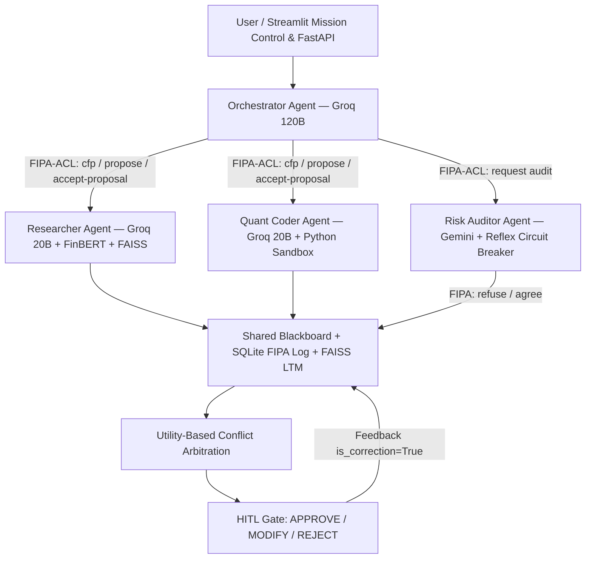

# QuantGuard-MAS — Autonomous Multi-Agent Financial Intelligence & Risk Advisory Platform

An end-to-end, **5-Model, 4-Agent** Agentic AI capstone platform developed for **23CSE4018 – Agentic AI** (Units I–IV). QuantGuard-MAS autonomously researches Indian NSE equities, computes quantitative risk metrics inside an AST-restricted Python sandbox, detects conflicting bullish vs. bearish market signals, arbitrates allocations using a risk-adjusted utility function, and pauses at a **Human-in-the-Loop (HITL)** approval gate with persistent **FAISS** feedback adaptation.

> **Disclaimer:** QuantGuard-MAS is an academic research and simulation platform built for educational evaluation. It does not provide financial advice and does not execute live brokerage trades (`ALLOW_AUTOMATIC_TRADE_EXECUTION=False` by default).

## 5-Model Architecture

| # | Model | Runtime / API | Assigned System Role | Engineering Rationale |
| :---: | :--- | :--- | :--- | :--- |
| 1 | `openai/gpt-oss-20b` | Groq API | Fast ReAct & Tool-Calling Agent (`ResearcherAgent`, `QuantCoderAgent`) | Low-latency structured reasoning, tool dispatch, and quantitative synthesis. |
| 2 | `openai/gpt-oss-120b` | Groq API | Deliberative Planner & Mediator (`OrchestratorAgent`) | Goal decomposition, Tree-of-Thought branching, and conflict arbitration. |
| 3 | `gemini-2.5-flash` | Google Gemini API | Independent Cross-Family Critic (`RiskAuditorAgent`) | Eliminates single-model blind spots during risk auditing and conflict triggers. |
| 4 | `ProsusAI/finbert` | Local Hugging Face | Traditional/Discriminative AI Sentiment Classifier | Deterministic 3-class financial headline sentiment (`Positive` / `Negative` / `Neutral`). |
| 5 | `sentence-transformers/all-MiniLM-L6-v2` | Local Hugging Face | Semantic Embedding Model (FAISS Long-Term Memory) | Embeds NSE company briefs and versioned user risk preferences for retrieval. |

## Course Syllabus Mapping (Units I–IV)

| Course Unit | Syllabus Topics | Concrete Implementation in QuantGuard-MAS |
| :--- | :--- | :--- |
| **Unit I: Intro & Agent Architectures** | PEAS, Reflex, Model-Based, Goal-Based, Utility-Based & Learning Agents | `environment/peas.py` (Indian equity PEAS simulator), `core/guardrails.py` (`ReflexCircuitBreaker` enforcing single-stock/cash/drawdown caps, `UtilityScorer` computing `U = Expected_Return - λ·Volatility - Fee`), and HITL feedback learning. |
| **Unit II: Reasoning, Planning & Decision-Making** | CoT, ToT, ReAct, Handling Uncertainty, Dynamic Replanning | `core/reasoning.py` comparing linear CoT, 3-branch Tree-of-Thought (Conservative/Balanced/Aggressive with utility scoring & pruning), and ReAct with mid-task `-12%` Market Shock dynamic replanning. |
| **Unit III: Memory, Tools & Environment Interaction** | Short-Term & Long-Term Memory, FAISS RAG, Feedback Adaptation, Sandboxed Execution | `core/memory_faiss.py` (persistent FAISS `IndexFlatIP` with `is_correction=True` non-destructive superseding) and `core/tools.py` (`fetch_market_data`, `finbert_sentiment`, AST `safe_calculator`, AST-restricted `python_sandbox` + Matplotlib risk charts). |
| **Unit IV: Multi-Agent Systems & Collaboration** | FIPA-ACL, Shared Blackboard, Contract Net, Conflict Resolution, HITL | `core/fipa_protocol.py` (SQLite-logged FIPA envelopes: `cfp`, `propose`, `accept-proposal`, `reject-proposal`, `inform`, `refuse`, `agree`, `request`) and `core/mas_graph.py` (4-agent orchestration, Bullish-vs-Bearish arbitration, HITL interrupt gate). |

## System Architecture



## Repository Structure

| Path | Responsibility |
| :--- | :--- |
| `app/dashboard.py` | 4-tab Streamlit Mission Control UI (Live Mission & HITL, Memory & RAG Inspector, Sandboxed Quant Lab, Course Benchmarks). |
| `app/api.py` | FastAPI REST service exposing `/health`, `/analyze`, `/shock-replan`, `/hitl-decision`, `/memory-audit`, `/usage-summary`, and `/fipa-log/{run_id}`. |
| `core/config.py` | Centralized `.env` configuration for all 5 models, risk caps, storage paths, and security flags. |
| `core/key_manager.py` | Multi-key pool manager (`GROQ_API_KEY_1..20`, `GEMINI_API_KEY_1..20`, plus unnumbered fallback) with automatic HTTP `429` failover rotation. |
| `core/llm_router.py` | Universal Groq + Gemini router with bounded retries, automatic `429` key rotation, cross-provider `json_mode`, and SQLite token/latency logging. |
| `core/guardrails.py` | `ReflexCircuitBreaker`, `UtilityScorer`, and `PromptInjectionSanitizer`. |
| `core/reasoning.py` | CoT, ToT, and ReAct engines with mid-task Market Shock dynamic replanning. |
| `core/memory_faiss.py` | Persistent FAISS Long-Term Memory (with automatic NumPy cosine fallback) and non-destructive feedback superseding. |
| `core/tools.py` | `fetch_market_data`, `finbert_sentiment`, AST `safe_calculator`, and AST-restricted `python_sandbox` with Matplotlib risk charting. |
| `core/fipa_protocol.py` | `FIPAMessage` envelopes, `SharedBlackboard` (SQLite `fipa_messages`), and `ContractNetBroker`. |
| `core/mas_graph.py` | 4-agent collaborative orchestrator, conflict arbitration round, and HITL interrupt workflow. |
| `environment/` | Reproducible Indian NSE `MarketSimulator`, INR `Portfolio` manager, and `QuantGuardEnvironment` (PEAS). |
| `evaluation/usage_tracker.py` | SQLite telemetry logger tracking requests, tokens, latency, and error rates per provider/model. |
| `benchmarks/` | Reproducible `ta1_reasoning_bench.py`, `ta2_memory_mas_bench.py`, and `final_ablation.py` scripts. |

## Verified Evaluation Benchmarks

* **TA1 (`benchmarks/ta1_reasoning_bench.py`):** Compares CoT, 3-branch ToT, and ReAct under a `-12%` shock on `RELIANCE.NS`, verifying dynamic replanning reduces shocked asset exposure to `0.0%` while preserving guardrail compliance.
* **TA2 (`benchmarks/ta2_memory_mas_bench.py`):** Verifies FAISS `is_correction=True` feedback superseding (`Active prefs=1, Archived=1`), AST Python sandbox security (blocking `import os`), and complete FIPA-ACL Contract Net + Arbitration traces (`17` logged messages, `AWAITING_HITL`).
* **Final Ablation (`benchmarks/final_ablation.py`):** Contrasts a Single-Agent Baseline (`Guardrail Compliant = False`, `42.0%` concentration breach, `0` FIPA messages) against 4-Agent QuantGuard-MAS (`Guardrail Compliant = True`, `0` violations, max single-asset weight capped at `27.1%`, cross-family Gemini + Reflex audit, `AWAITING_HITL`).

## Quickstart

### 1. Environment & Dependencies

```powershell
conda activate dl
cd QuantGuard-MAS
python -m pip install -r requirements.txt
```

### 2. Configure `.env`

```env
GROQ_API_KEY_1=your_groq_key
GEMINI_API_KEY_1=your_gemini_key
GROQ_ACTIVE_KEY=1
GEMINI_ACTIVE_KEY=1
```

### 3. Launch Streamlit Mission Control

```powershell
python -m streamlit run app/dashboard.py
```

### 4. Launch FastAPI REST Backend

```powershell
python -m uvicorn app.api:app --reload --port 8000
```

Interactive Swagger API docs are served at `http://127.0.0.1:8000/docs`.

### 5. Run Evaluation Benchmarks via CLI

```powershell
python -m benchmarks.ta1_reasoning_bench
python -m benchmarks.ta2_memory_mas_bench
python -m benchmarks.final_ablation
```

## REST API Reference

| Method | Endpoint | Purpose |
| :--- | :--- | :--- |
| `GET` | `/health` | Service status, default currency (`INR`), and HITL configuration |
| `POST` | `/analyze` | Launch 4-agent MAS portfolio mission (pauses at `AWAITING_HITL`) |
| `POST` | `/shock-replan` | Inject a mid-task asset shock and trigger dynamic replanning + arbitration |
| `POST` | `/hitl-decision` | Submit `APPROVE`, `MODIFY`, or `REJECT` with optional FAISS preference correction |
| `GET` | `/memory-audit` | Inspect active and superseded FAISS Long-Term Memory records |
| `GET` | `/usage-summary` | Retrieve aggregated SQLite token and latency telemetry per provider/model |
| `GET` | `/fipa-log/{run_id}` | Fetch the persisted SQLite FIPA-ACL message trace for a mission run |
